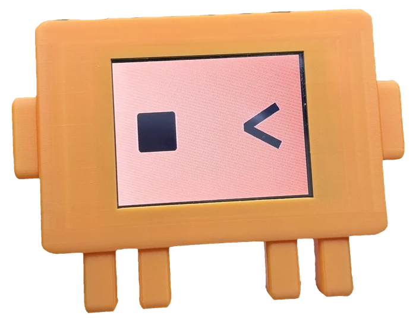
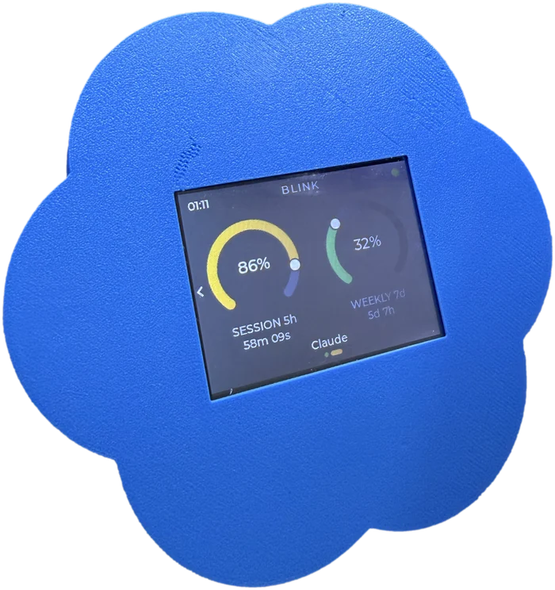
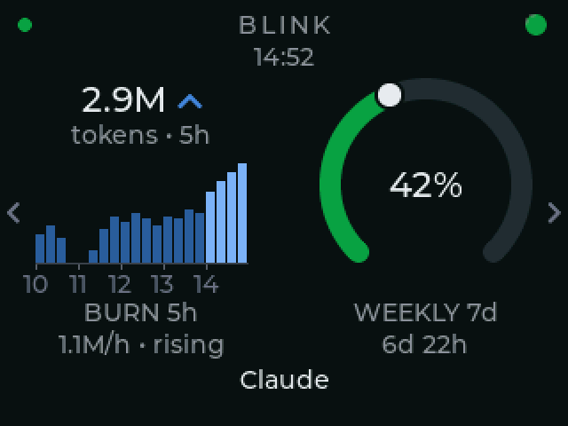

<div align="center">

<a href="https://blink-buddy.com"></a>

**Your Claude Code and Codex usage, as two live dials on your desk.**

<p>
  <a href="https://github.com/KfirLevy258/Blink/releases/latest"></a>
  <a href="https://docs.anthropic.com/en/docs/claude-code"></a>
  <a href="https://github.com/openai/codex"></a>
</p>
<p>
  
  
  
  <a href="LICENSE"></a>
</p>

<table>
  <tr>
    <td align="center"></td>
    <td align="center"></td>
  </tr>
  <tr>
    <td align="center"><sub><b>Claude edition</b></sub>&nbsp;</td>
    <td align="center"><sub><b>Codex edition</b></sub>&nbsp;</td>
  </tr>
</table>

### Don't want to build one? &nbsp;[**blink-buddy.com**](https://blink-buddy.com)

I build them, test them and post them.

</div>

## What it is

BLINK is a small touchscreen that shows the same numbers as Claude Code's `/usage` command, always in view: your **5-hour session** and your **7-day week**, each as a dial that turns from green to amber to red, with a countdown to its reset. It plugs into your computer over USB, sets itself up in one command, and keeps itself updated.

## Open source

**BLINK is open source, and it is free.** Everything the device is made of is
here: the firmware that draws the dials, the app that reads your usage, the
build scripts, the tests. Nothing is held back, nothing is a trial, nothing
expires. The board is an ESP32 "Cheap Yellow Display", about $12 anywhere, and
the case is a 3D print - the files are on
[MakerWorld](https://makerworld.com/en/models/3294736-blink-claude-code-codex-usage-monitor).

**You can do anything you like with it, for yourself.** Build one. Build ten.
Change it, rewrite it, put your own name on it. Give them to your friends. Use
it at home, at school, in a club. You will never owe me anything for it.

**The one thing you cannot do is sell it.** Not the device, not the software,
not a product with this inside it. Making money out of BLINK is the only thing
the licence forbids. If that is what you want to do, write to me and ask -
the answer is often yes.

And if you would rather not build one at all, I sell finished units, put
together and tested by hand. That is what pays for the work that goes into
this.

## Features

- **Two dials, two countdowns.** Session and weekly limits, and the time until each one resets.
- **An activity light.** Amber the moment any session - Claude or Codex - is waiting on you; a green pulse while everything is still working; red when a turn dies on an error - a rate limit, most often.
- **A page per provider.** Claude and Codex each get their own screen. Swipe to switch; the needles move from one reading to the other.
- **It sleeps when your computer does.** About thirty seconds after the computer stops answering, the screen closes its eyes and dozes; it opens them the moment the computer is back. A tap while it sleeps shows the last figures.
- **Claude Desktop too.** With Desktop alone the dials show percentages, a five-hour countdown whenever Desktop is holding a reset time, and a weekly countdown once one has been learned. Desktop keeps that reset time only while a window is running and clears it in between, so the countdown comes and goes; the fill rate covers the gaps. The dials follow Desktop's own refresh - about every 5 minutes while you are using it, up to 15 when it sits idle - where Claude Code updates them live.
- **Nothing to sign in to.** It reads figures Claude Code and Codex have already written to disk. No credential, and nothing about you sent anywhere. The one optional extra, status-page alerts, reads the public status pages and is off until you turn it on.
- **Themes.** Twelve built in, three of them light for a bright room, and one of your own: seven colours, arc width and ends, made in a builder that opens in your browser from the board's own Settings (or `blink theme`) and previews on the panel as you edit. A custom theme travels as a short share code.
- **Focus.** One window big instead of two - session or weekly - with the other kept as a line under it.
- **A burn view where there is no five-hour limit.** Claude Ultra accounts have no five-hour window (from 2026-10-30), so a session dial would have nothing to show. There, BLINK draws the last five hours of Claude Code output instead: the total, an arrow for whether you are speeding up or easing off, and a bar for every quarter-hour, labelled with the hour. Pro and Max keep the session dial, and the weekly dial is the same on every plan.
- **Settings on the board.** Brightness, Theme, Focus and Update, four tiles on the screen beside the dials.
- **Status pages, per provider.** Optional: each provider's page says when that provider's own service is having trouble, so you know it is not your machine.
- **Updates over the cable.** A new release asks on screen; one tap installs both the firmware and the app. Both halves are signed.
- **Cheap, open hardware.** An ESP32 "Cheap Yellow Display" (~$12) and a 3D-printed case.
- **Company units.** A unit built for a company shows its logo - a still or a short clip - after the boot animation, written once at the factory.

## The screens

<table>
  <tr>
    <td width="25%"></td>
    <td width="25%"></td>
    <td width="25%"></td>
    <td width="25%"></td>
  </tr>
  <tr>
    <td align="center"><sub><b>Claude</b></sub>&nbsp;</td>
    <td align="center"><sub><b>Codex</b></sub>&nbsp;</td>
    <td align="center"><sub><b>Desktop alone</b></sub>&nbsp;</td>
    <td align="center"><sub><b>No five-hour window</b></sub>&nbsp;</td>
  </tr>
</table>

Session and weekly, the countdown to each reset, and the time under the wordmark.
The marks in the top-left corner are your live sessions - one per session,
coloured by what each is doing. Claude and Codex each get a page of their own,
and a swipe moves between them. With Claude Desktop alone there is often no reset
time to count down to, so the session dial shows how fast it is filling instead.
On an account with no five-hour window, such as Claude Ultra, the session dial
gives way to the burn view: Claude Code's output over the last five hours, a
bar per quarter-hour, and an arrow comparing this hour with the one before.

*Rendered by the shipping firmware's own drawing code, not mocked up.*

## Setup

One file. Download it, run it, delete it. It copies itself to `~/.blink/bin`, finds the board, and starts again every time you log in.

```bash
# macOS (Apple silicon)
curl -fsSL https://github.com/KfirLevy258/Blink/releases/latest/download/blink-macos-arm64.tar.gz | tar xz && ./blink/blink
# macOS (Intel):  .../blink-macos-x86_64.tar.gz
# Linux:          .../blink-linux-x86_64.tar.gz

```

On Windows, in PowerShell or Command Prompt:

```
curl.exe -fsSL -o blink.zip https://github.com/KfirLevy258/Blink/releases/latest/download/blink-windows-x86_64.zip && tar -xf blink.zip && .\blink\blink.exe
```

Windows on Arm (Snapdragon laptops, Surface Pro X) gets the Arm64 build of the USB chip's driver, and works: tested on Windows 11 on Arm with a real board. The rest of BLINK's Windows checks were done on an x64 PC.

```bash
~/.blink/bin/blink status      # is the panel getting data?
~/.blink/bin/blink uninstall   # put everything back
```

Needs Claude Code 2.1.100 or newer. The installer changes one file, `~/.claude/settings.json` (the status line command and one hook per lifecycle event), says so before it does, and keeps your own status line running. Everything it does is reversible with `uninstall`.

## Something's wrong?

```bash
~/.blink/bin/blink status
```

That one command says whether the service is running, whether Claude Code and Codex are being read, and how old the numbers are. If the panel is dark or wrong, unplug the board and plug it back in first - the app finds it again on its own. If that does not fix it, email **support@blink-buddy.com** with the output of `blink status` and the last lines of `~/.blink/bridge.log`; nothing in either is a secret.

**If the board says the app is old.** The board and the app ship together, so normally they match. If they have come apart - the board on a later version than the computer - the board's own update screen cannot fix it, because the half that is behind is the half it cannot reach. `blink status` says so and names the cure:

```
Board       COM25 (CH340) -- id 20500d33ff1c, firmware 1.3.2
            the board is on 1.3.2 and this app is 1.3.1 -- they ship together
            run: blink update
```

**On Windows, if the board never appears:** the board's USB chip needs a driver Windows does not ship, and the installer puts it in for you - it is the one step that asks for the Windows permission prompt, and it only asks when there is something to install. If you skipped that prompt, or installed an older version, run:

```
%USERPROFILE%\.blink\bin\blink.exe driver
```

`blink status` says which of these you are looking at: a board Windows cannot use yet reads as *"a board is plugged in, but Windows has no driver for it"*, not as an empty desk.

## What it works with

For Claude Desktop, the app learns usage by reading Claude Desktop's own local files on your machine, never anything else - it only ever reads them, and nothing about your usage or your conversations ever leaves the machine.

| You use | You get |
|---|---|
| Claude Code, in a terminal or an IDE | Everything |
| Codex CLI | Everything, on its own page |
| Claude Code in Claude Desktop's Code tab | The same as Desktop below, plus the activity light: the Code tab runs Claude Code's hooks, though not its status line, so the figures are Desktop's rather than Claude Code's |
| Claude Desktop, without Claude Code | Five-hour percentage and countdown, refreshed within seconds of a turn; weekly percentage on Desktop's own schedule (about 5 min in use, up to 15 idle); a weekly countdown too, once one has been learned, published only while nothing contradicts it; no activity light |
| claude.ai in a browser | Nothing - there is no usage data to read |

## Privacy

BLINK never sees a credential and never sends your usage or your sessions anywhere. If you turn on status-page alerts (`blink config status-page on`), it reads status.claude.com, and status.openai.com for a Codex page, every 5 minutes, with nothing of yours attached. It keeps the last usage payload Claude Code wrote, readable by you alone, in `~/.blink/`. The device holds no token: nothing to leak, nothing to revoke if you lend it.

## Building units

`tools/burn.sh` programs a unit end to end: it builds signed firmware with the bootloader, flashes it, stamps the edition (Claude or Codex, write-once), and confirms the stamp survives a power cycle. Add `--logo` and the unit shows a company logo after the boot animation. The script fails loudly rather than half-succeeds, and CI runs it on every push against a scripted board so a change to it cannot quietly ship a unit that boots wrong. Details in [docs/README-full.md](docs/README-full.md#programming-a-unit).

## Read more

- **[The full README](docs/README-full.md)** - how the numbers are found, what the installer changes line by line, ports and multiple boards, updates and signing, the decisions behind the first release
- **[firmware/README.md](firmware/README.md)** - building, flashing and signing the firmware yourself
- **[docs/multi-provider.md](docs/multi-provider.md)** - how two sources are merged into one reading
- **[docs/windows-check.md](docs/windows-check.md)** - the ten-minute check a Windows release needs a person for
- **[docs/fleet-testing.md](docs/fleet-testing.md)** - the one command that proves a release on three real desks and three real boards, the narrower VM fleet that can stand in for them, and what a green run does and does not prove

<div align="center">
<sub>Firmware: Zephyr, C. App: Python, one binary.</sub>&nbsp;<br>
<sub>Board: ESP32-2432S028.</sub>&nbsp;<br>
<sub>Source under <a href="LICENSE">PolyForm Noncommercial 1.0.0</a>.</sub>&nbsp;<br>
<sub>Free to build for yourself. Never to sell.</sub>&nbsp;<br>
<sub>Built units at <a href="https://blink-buddy.com">blink-buddy.com</a>.</sub>&nbsp;
</div>
