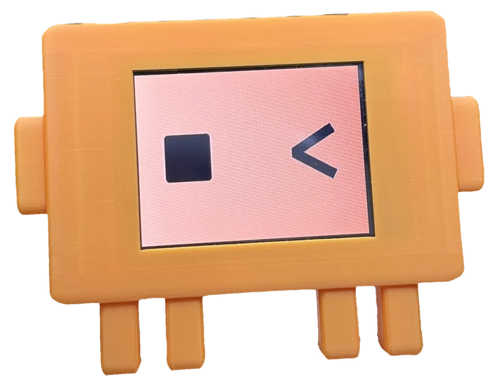
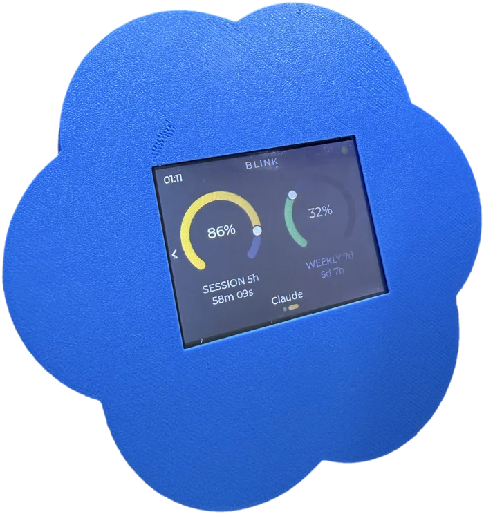
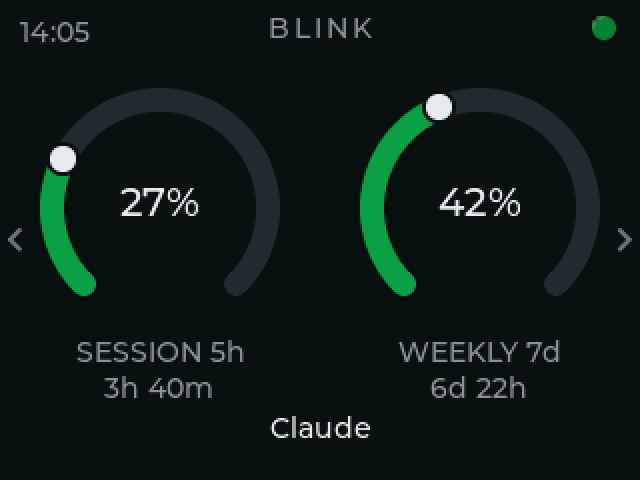
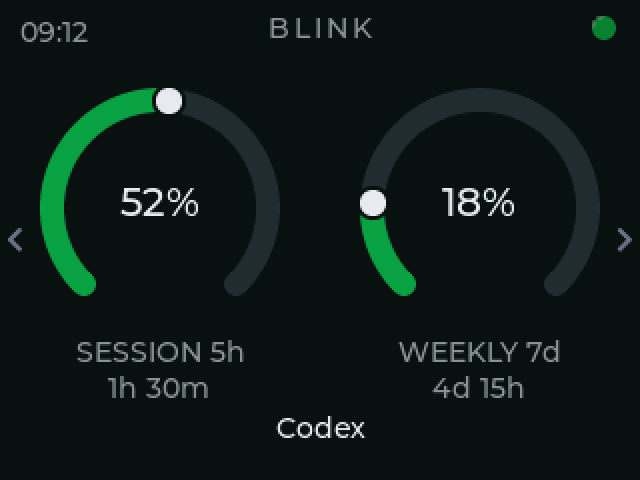
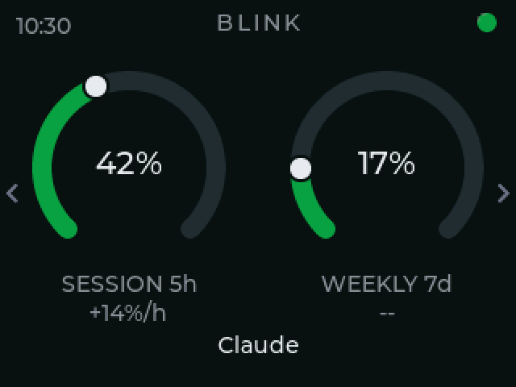
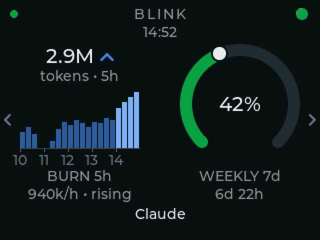
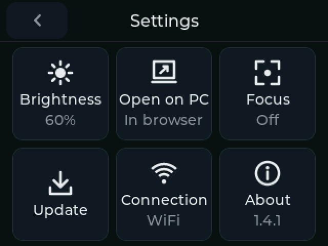
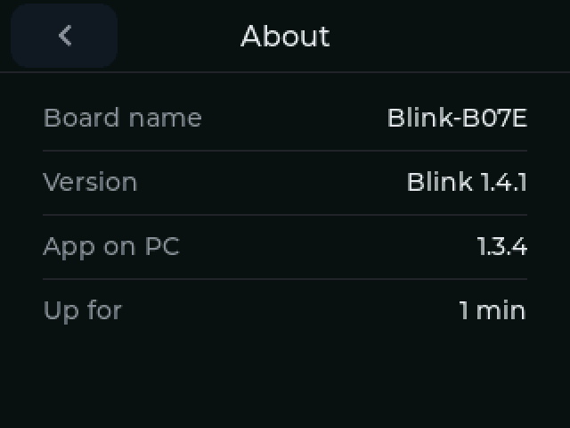
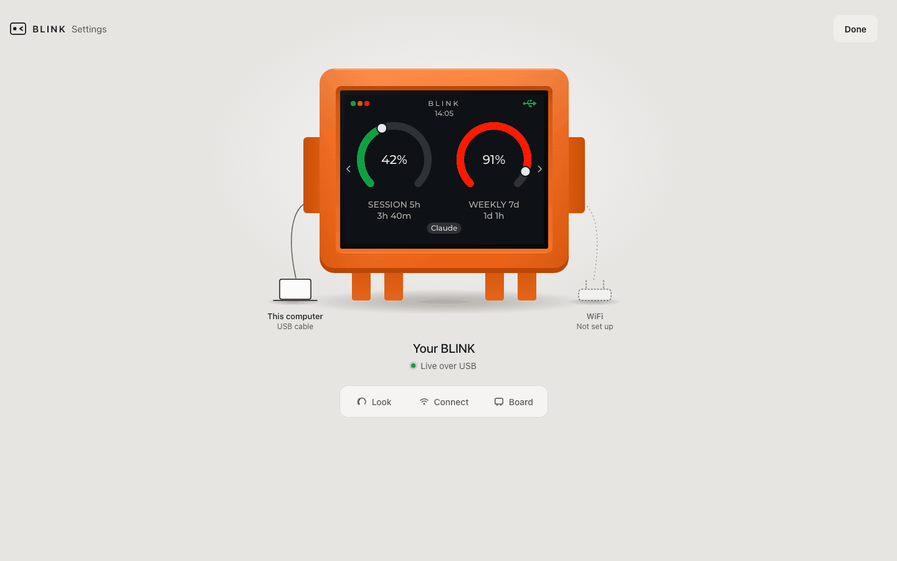
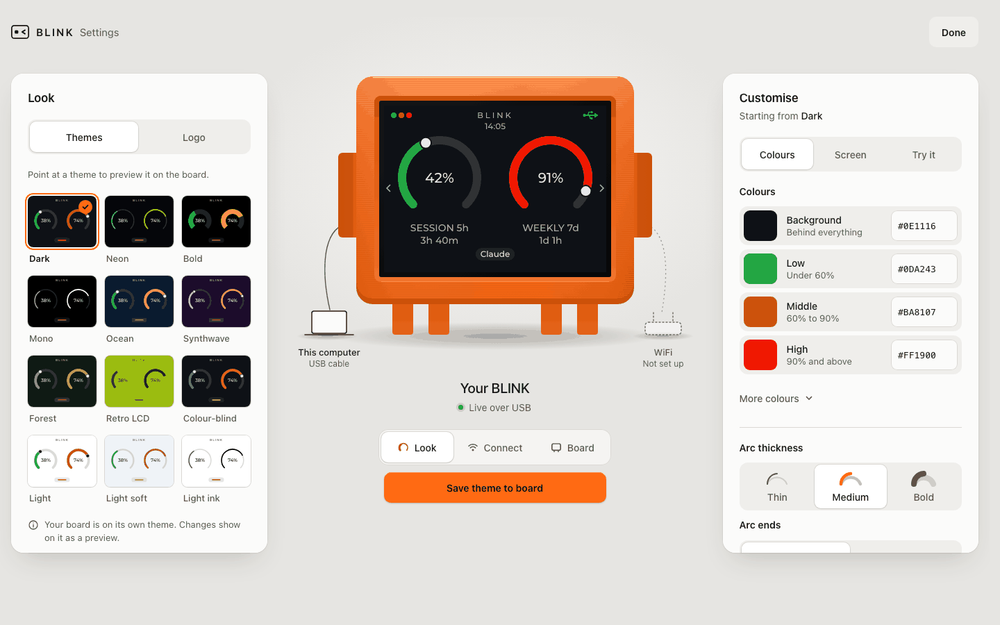

<div align="center">

<a href="https://blink-buddy.com"></a>

**Your Claude Code and Codex usage, as two live dials on your desk.**

<p>
  <a href="https://github.com/KfirLevy258/Blink/releases/latest"></a>
  <a href="https://docs.anthropic.com/en/docs/claude-code"></a>
  <a href="https://github.com/openai/codex"></a>
</p>
<p>
  
  
  
  <a href="LICENSE"></a>
</p>

<table>
  <tr>
    <td align="center"></td>
    <td align="center"></td>
  </tr>
  <tr>
    <td align="center"><sub><b>Claude edition</b></sub>&nbsp;</td>
    <td align="center"><sub><b>Codex edition</b></sub>&nbsp;</td>
  </tr>
</table>

### Don't want to build one? &nbsp;[**blink-buddy.com**](https://blink-buddy.com)

I build them, test them and post them.

</div>

## What it is

BLINK is a small touchscreen that shows the same numbers as Claude Code's `/usage` command, always in view: your **5-hour session** and your **7-day week**, each as a dial that turns from green to amber to red, with a countdown to its reset. It plugs into your computer over USB, or talks to it over WiFi if you set that up, sets itself up in one command, and keeps itself updated.

BLINK is open source and free: the firmware, the app, the build scripts and the tests are all here, and the case is a 3D print ([MakerWorld](https://makerworld.com/en/models/3294736-blink-claude-code-codex-usage-monitor)) around an ESP32 "Cheap Yellow Display" (about $12). Build as many as you like, for yourself, and change anything. The one thing the licence forbids is selling it, as a device, as software or inside a product; if that is what you want, write to me and ask. I also sell finished units, put together and tested by hand, which is what pays for the work.

## What it shows

- **Two dials, two countdowns.** Session and weekly limits, and the time until each one resets.
- **An activity light.** Amber the moment any session, Claude or Codex, is waiting on you; a green pulse while everything is still working; red when a turn dies on an error, a rate limit most often.
- **A page per provider.** Claude and Codex each get their own screen. Swipe to switch.
- **Claude Desktop too.** With Desktop alone the dials show percentages and a fill rate, and countdowns whenever Desktop holds a reset time. See "What it works with".
- **A burn view where there is no five-hour limit.** Claude Ultra accounts have no five-hour window (from 2026-10-30), so there BLINK draws the last five hours of Claude Code output instead: the total, an arrow for speeding up or easing off, and a bar per quarter-hour. The weekly dial is the same on every plan.
- **It sleeps when your computer does.** About thirty seconds after the computer stops answering, the screen dozes; a tap shows the last figures.
- **Optional status-page alerts.** Off until you turn them on: the panel says when a provider's own service is having trouble, so you know it is not your machine.
- **Company units.** A unit built for a company shows its logo after the boot animation.

It needs no sign-in: it reads figures Claude Code and Codex have already written to disk, and sends nothing about you anywhere.

<table>
  <tr>
    <td width="25%"></td>
    <td width="25%"></td>
    <td width="25%"></td>
    <td width="25%"></td>
  </tr>
  <tr>
    <td align="center"><sub><b>Claude</b></sub>&nbsp;</td>
    <td align="center"><sub><b>Codex</b></sub>&nbsp;</td>
    <td align="center"><sub><b>Desktop alone</b></sub>&nbsp;</td>
    <td align="center"><sub><b>No five-hour window</b></sub>&nbsp;</td>
  </tr>
</table>

Session and weekly, the countdown to each reset, and the time under the wordmark.
The marks in the top-left corner are your live sessions - one per session,
coloured by what each is doing. Claude and Codex each get a page of their own,
and a swipe moves between them. With Claude Desktop alone there is often no reset
time to count down to, so the session dial shows how fast it is filling instead.
On an account with no five-hour window, such as Claude Ultra, the session dial
gives way to the burn view: Claude Code's output over the last five hours, a
bar per quarter-hour, and an arrow comparing this hour with the one before.

*Rendered by the shipping firmware's own drawing code, not mocked up.*

## Install

One file. Download it, run it, delete it. It copies itself to `~/.blink/bin`, finds the board, and starts again every time you log in.

```bash
# macOS (Apple silicon)
curl -fsSL https://github.com/KfirLevy258/Blink/releases/latest/download/blink-macos-arm64.tar.gz | tar xz && ./blink/blink
# macOS (Intel):  .../blink-macos-x86_64.tar.gz
# Linux:          .../blink-linux-x86_64.tar.gz

```

On Windows, in PowerShell or Command Prompt:

```
curl.exe -fsSL -o blink.zip https://github.com/KfirLevy258/Blink/releases/latest/download/blink-windows-x86_64.zip && tar -xf blink.zip && .\blink\blink.exe
```

Windows on Arm (Snapdragon laptops, Surface Pro X) gets the Arm64 build of the USB chip's driver, and works: tested on Windows 11 on Arm with a real board. The rest of BLINK's Windows checks were done on an x64 PC.

```bash
~/.blink/bin/blink status      # is the panel getting data?
~/.blink/bin/blink uninstall   # put everything back
```

Needs Claude Code 2.1.100 or newer. The installer changes Claude Code's `settings.json` (in `~/.claude`, or the folder `CLAUDE_CONFIG_DIR` names: the status line command and one hook per lifecycle event), Codex's `hooks.json` when Codex is installed, and `~/.blink/config.json`, where it records which Claude Code folder it set up; it says all of it before it does it, and keeps your own status line running. Everything it does is reversible with `uninstall`.

## Settings on the board

The board's Settings screen has six tiles.

<table>
  <tr>
    <td width="50%"></td>
    <td width="50%"></td>
  </tr>
  <tr>
    <td align="center"><sub><b>Settings</b></sub>&nbsp;</td>
    <td align="center"><sub><b>About</b></sub>&nbsp;</td>
  </tr>
</table>

**Brightness**, **Open on PC** (opens the settings page below), **Focus** (one window big instead of two, with the other as a line under it), **Update**, **Connection** (the link in use; WiFi details and **Forget WiFi** are on its screen) and **About** (board name, firmware and app versions, time up).

## The settings page



Tap **Open on PC** on the board, or run `blink settings`, and the page opens in your browser. It has three tabs:

- **Look** holds the twelve built-in themes (three of them light), the theme builder and your own logo. A custom theme is seven colours plus arc width and ends, previews on the board as you edit, and travels as a short share code. The logo takes a PNG, JPG, SVG or an animated GIF. `blink theme` opens the page on Look.
- **Connect** moves the board to WiFi.
- **Board** holds its preferences.



## WiFi

WiFi is an opt-in second link; USB stays the default and wins whenever the cable is plugged in. On the Connect tab press **Move to WiFi**, pick your network and type its password. The cable is needed once, to hand the board the network and pair it with this computer. After that the link is encrypted and the board works from a phone charger. It needs a 2.4 GHz WPA2 network that lets devices see each other. The limits, **Forget WiFi** and a known restart when you plug the cable into a WiFi board are in the [full README](docs/README-full.md#wifi).

## Updates

A new release asks on screen; one tap installs both the firmware and the app, and both are signed. Over the cable the app writes the image and reads it back. Over WiFi the board writes a spare slot and test-boots it, and reverts on its own if the new version has not confirmed within 90 seconds. Details in the [full README](docs/README-full.md#updates). To update the app by itself, run `blink update`.

## Troubleshooting

```bash
~/.blink/bin/blink status
```

That one command says whether the service is running, whether Claude Code and Codex are being read, and how old the numbers are. If the panel is dark or wrong, unplug the board and plug it back in first - the app finds it again on its own. If that does not fix it, email **support@blink-buddy.com** with the output of `blink status` and the last lines of `~/.blink/bridge.log`; nothing in either is a secret.

**If the board says the app is old.** The board and the app ship together, so normally they match. If they have come apart - the board on a later version than the computer - the board's own update screen cannot fix it, because the half that is behind is the half it cannot reach. `blink status` says so and names the cure:

```
Board       COM25 (CH340) -- id 20500d33ff1c, firmware 1.3.2
            the board is on 1.3.2 and this app is 1.3.1 -- they ship together
            run: blink update
```

**On Windows, if the board never appears:** the board's USB chip needs a driver Windows does not ship, and the installer puts it in for you - it is the one step that asks for the Windows permission prompt, and it only asks when there is something to install. If you skipped that prompt, or installed an older version, run:

```
%USERPROFILE%\.blink\bin\blink.exe driver
```

`blink status` says which of these you are looking at: a board Windows cannot use yet reads as *"a board is plugged in, but Windows has no driver for it"*, not as an empty desk.

## What it works with

For Claude Desktop, the app learns usage by reading Claude Desktop's own local files on your machine, never anything else - it only ever reads them, and nothing about your usage or your conversations ever leaves the machine.

| You use | You get |
|---|---|
| Claude Code, in a terminal or an IDE | Everything |
| Codex CLI | Everything, on its own page |
| Claude Code on a usage-billed seat | The month's spend against the seat's cap: exact after `/usage` in a terminal, estimated between runs; no five-hour or weekly window |
| Claude Code inside WSL on Windows | Everything, once you run `blink install --wsl <name>` with the distribution's name (`blink install --wsl` alone lists them). Blink stays on Windows with the board; it never looks into WSL unless you name a distribution, reads Claude Code's files there while you are using it, checks every five minutes that its status line is still in place there while the distribution is running anyway (never starting it to do so), and reads that Claude Code and not one on Windows |
| Claude Code in Claude Desktop's Code tab | The same as Desktop below, plus the activity light: the Code tab runs Claude Code's hooks, though not its status line, so the figures are Desktop's rather than Claude Code's |
| Claude Desktop, without Claude Code | Five-hour percentage and countdown, refreshed within seconds of a turn; weekly percentage on Desktop's own schedule (about 5 min in use, up to 15 idle); a weekly countdown too, once one has been learned, published only while nothing contradicts it; no activity light |
| claude.ai in a browser | Nothing - there is no usage data to read, unless you also have Claude Code (next row) |
| Claude Desktop or claude.ai in a browser, with Claude Code installed | Kept fresh by an optional background `/usage` run of your own Claude Code (off unless you say yes; see [Keeping figures fresh](docs/README-full.md#keeping-figures-fresh)) |

BLINK is an independent product. It is not affiliated with, endorsed by or sponsored by Anthropic or OpenAI. Claude and Claude Code are trademarks of Anthropic, PBC; Codex and OpenAI are trademarks of OpenAI.

## Privacy

BLINK keeps no credential and never sends your usage or your sessions anywhere. If you turn the usage refresh on, BLINK runs your own Claude Code's `/usage` in the background now and then; it sends no message and keeps nothing from it but the figures Claude Code saves. If you turn on status-page alerts (`blink config status-page on`), it reads status.claude.com, and status.openai.com for a Codex page, every 5 minutes, with nothing of yours attached. It keeps the last usage payload Claude Code wrote, readable by you alone, in `~/.blink/`, and reads the usage figures, the session id and the session's cost from it. To tell an Ultra plan from Pro or Max, it reads Claude Code's config, `~/.claude.json`: the whole file is parsed in memory, and it can hold your MCP servers' tokens (and, on Linux and Windows, an API key), but only the plan name and rate-limit tier, the seat type (`oauthAccount.seatTier`, `billingType`), the account and organisation ids, and on a usage-billed seat the spend Claude Code saved at the last `/usage`, are looked at. Nothing from the file is logged. On a usage-billed seat a one-way fingerprint of the two ids, each session's id with its highest cost estimate and when that was first seen or last rose, each rise in cost counted in the last five hours with its time (for the board's quarter-hour view), the month's total of older ones and the time of the last `/usage` are kept in `~/.blink/spend-count.json`. Between `/usage` runs that figure is an estimate; just after a `/login` to another account the spend page can be blank until Claude Code next draws its status line, or show the old account's figures once, because the status line does not say which account drew it. While the account is marked as having no five-hour limit it also reads the output-token count of each reply from Claude Code's transcripts (the next five-hour figure Claude Code shows lifts the mark, and the reading stops), and on a Codex account with none (such as Codex Pro) every token count of each turn from Codex's session log, held in memory until five hours after Codex last wrote that turn (board plugged in or not), of which only the output tokens are added up. It sends the board only a total per quarter-hour, never the conversation. [docs/README-full.md](docs/README-full.md#what-the-installer-changes) lists exactly what is read and kept. The device holds no token: nothing to leak, nothing to revoke if you lend it.

## Building units

`tools/burn.sh` programs a unit end to end: it builds signed firmware, flashes it, stamps the edition (Claude or Codex, write-once) and confirms the stamp survives a power cycle; add `--logo` for a company logo. Details in [docs/README-full.md](docs/README-full.md#programming-a-unit).

## Read more

- **[The full README](docs/README-full.md)** - how the numbers are found, what the installer changes line by line, ports and multiple boards, updates and signing, the decisions behind the first release
- **[firmware/README.md](firmware/README.md)** - building, flashing and signing the firmware yourself
- **[docs/multi-provider.md](docs/multi-provider.md)** - how two sources are merged into one reading
- **[docs/windows-check.md](docs/windows-check.md)** - the ten-minute check a Windows release needs a person for
- **[docs/fleet-testing.md](docs/fleet-testing.md)** - the one command that proves a release on three real desks and three real boards, the narrower VM fleet that can stand in for them, and what a green run does and does not prove

<div align="center">
<sub>Firmware: Zephyr, C. App: Python, one binary.</sub>&nbsp;<br>
<sub>Board: ESP32-2432S028.</sub>&nbsp;<br>
<sub>Source under <a href="LICENSE">PolyForm Noncommercial 1.0.0</a>.</sub>&nbsp;<br>
<sub>Free to build for yourself. Never to sell.</sub>&nbsp;<br>
<sub>Built units at <a href="https://blink-buddy.com">blink-buddy.com</a>.</sub>&nbsp;
</div>
