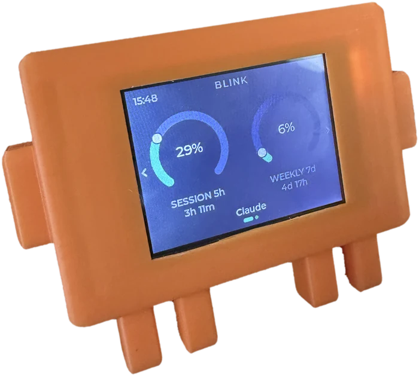
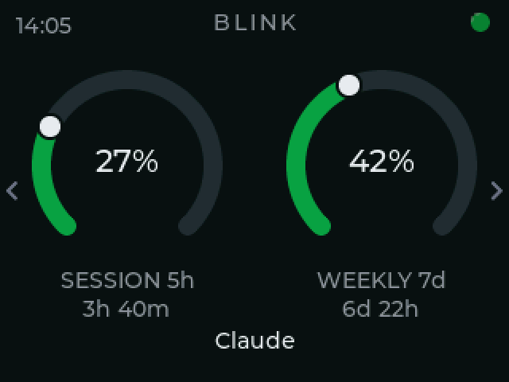
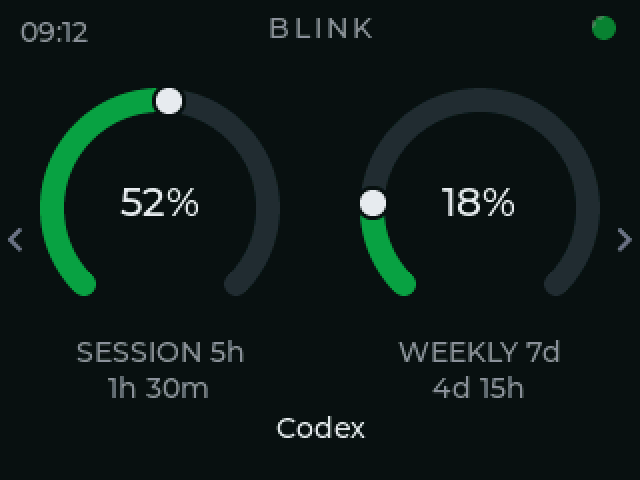
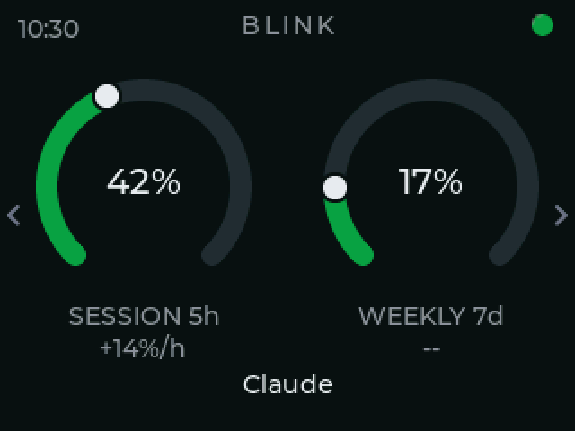

<div align="center">


**A little desk gauge for your Claude Code and Codex usage.**
Your 5-hour session and 7-day week, as two live dials you can glance at all day.

<p>
  <a href="https://github.com/KfirLevy258/Blink/releases/latest"></a>
  
  
  
</p>



</div>

<table>
  <tr>
    <td width="33%"></td>
    <td width="33%"></td>
    <td width="33%"></td>
  </tr>
  <tr>
    <td align="center"><sub><b>Claude</b></sub>&nbsp;</td>
    <td align="center"><sub><b>Codex</b></sub>&nbsp;</td>
    <td align="center"><sub><b>Desktop alone</b></sub>&nbsp;</td>
  </tr>
</table>

Session and weekly, the countdown to each reset, and the time under the wordmark.
The marks in the top-left corner are the live sessions, one per session, coloured
by what each is doing.

*The three screens above are rendered from the shipping firmware's own drawing code (`tools/panel_render`), not mocked up.*

## What is Blink?

Blink is a small desk display that shows how much of your Claude Code usage you've spent - the same numbers as the `/usage` command, but always in view. It reads your **5-hour session** limit and your **7-day weekly** limit and draws each as a dial, green while you have room, amber as you get close, red when it's nearly gone. Glance over, know where you stand, keep working.

Beside the dials is a small pip telling you whether anything is waiting on you - across every Claude Code and Codex session you have open, one light: amber the moment a session has finished or is asking permission, a green pulse while everything is still working, red when something is stuck or rate-limited. Under them, a countdown to each window's reset.

It runs on a cheap (~$12) ESP32 touchscreen. Plug it into your computer, run the setup once, and it sits on your desk and keeps itself up to date.

### Where the numbers come from

Blink never sees a credential and never sends your usage or your sessions anywhere. (If you turn on status-page alerts, it reads the public status pages every 5 minutes; see "Security & privacy".) It reads figures other programs have already worked out, from files they already write: from Codex's session log it takes the rate-limit line, the folder each session runs in and when each turn starts and ends, and on an account with no five-hour limit the token counts, and nothing of the conversation; from Claude Code's status line it keeps the last payload (which also names your working directory and session), readable by you alone, and reads the usage figures, the session id and the session's cost out of it. On an account with no five-hour window it also reads the output-token counts in Claude Code's transcripts, or, for a Codex account with none, every token count of each turn in Codex's session log, held in memory until five hours after Codex last wrote that turn (board plugged in or not) with only the output tokens added up, and sends the board only a total per quarter-hour; see "What the installer changes" for exactly what is read.

### What it supports, and how well

| You use | What the panel shows | |
|---|---|---|
| **Claude Code in a terminal** | Everything: both limits, both countdowns, the activity light. An account with no five-hour window (verified Ultra, from 2026-10-30) has no session dial to show, so the left half becomes the burn view: Claude Code's output tokens over the last five hours, a bar per quarter-hour labelled with the hour, and an arrow for whether the last hour ran faster or slower than the one before. `blink status` says when the account has no window. BLINK decides that only on proof, so a new Ultra desk keeps `--%` for its first five and a quarter hours or so of Claude Code use (a break of over an hour, or a restart of the daemon, starts that count again. So does closing the lid or unplugging the board for most of an hour, because replies made while it is closed or unplugged are not seen: about 58 minutes if Claude Code replies every two minutes, 50 if every ten. A shorter gap does not), and any five-hour figure Claude Code shows after that brings the session dial back. The weekly limit is unchanged. Until the first burn line arrives, the dial reads `--%`. The view counts Claude Code only: Desktop and claude.ai chats leave no token counts on disk. | **Full** |
| **Claude Code in the VS Code / JetBrains extension** | The same. The extension runs the same CLI and reads the same `~/.claude/settings.json`, so the status line and hooks work identically | **Full** |
| **Claude Code in Claude Desktop's Code tab** | What Desktop chat gets (below), plus the activity light: the Code tab runs its own copy of Claude Code, which reads `~/.claude/settings.json`, so the hooks fire. It runs headless, so the status line never does, and the figures come from Desktop's files rather than from Claude Code. Measured on macOS (2026-09-26) and Windows 11 ARM64 (2026-09-30) | **Partial** |
| **Claude Desktop chat, without Claude Code** | Both percentages and the five-hour countdown whenever Desktop holds a reset time (the fill rate covers the gaps). The five-hour figure and its countdown come from Desktop's Local Storage, refreshed within seconds of a turn; the weekly percentage follows Desktop's own refresh: about every 5 minutes while it is in use, every 15 (occasionally 30) when it sits idle, and at once when its usage panel is opened. The weekly countdown once learned, `--` until then. **No activity light** | **Partial** |
| **Codex CLI** | Both limits and both countdowns, on its own page | **Full** |
| **claude.ai in a browser** | Nothing | **Not supported** |

**How current the Desktop figure is.** This is the weekly percentage; the five-hour one comes from Local Storage within seconds of a turn (below). BLINK never asks the server; it reads the sample Desktop last wrote. Measured over 1,672 samples on one Mac (July-August 2026): Desktop writes one every 5 minutes while it is being used, every 15 minutes in the background (occasionally 30), and immediately when its usage panel is opened. The daemon reads the file every minute, so the board is at most a minute behind Desktop, and Desktop is at most 5-15 minutes behind the server. A person watching the board while the app sits idle sees the figure move in 15-minute steps - reported 2026-08-30 as "stuck on 16 %, then 21 %" - which is the app's clock, not a fault.

**Sleep.** The board pings the app every 10 s. Thirty seconds without an answer, on a board that has shown figures this boot and is not mid-update, means the computer is asleep: the screen plays a closing clip, loops a sleeping one, and plays an opening clip when the app answers again. Uninstall sends a `bye` first so a removed app shows "connecting" instead. Clips: `tools/make_sleepanim.py`; design: `docs/sleep-mode-design.md`.

**Why Claude Desktop is only half.** The five-hour window has a real countdown: Claude Desktop's own Local Storage carries a reset time next to its percentage, refreshed within seconds of a turn. The seven-day window does not - an exhaustive search in August 2026 (every JSON file the app writes, its LevelDB, Session Storage and IndexedDB stores, its caches and its preferences plist) found no seven-day reset time anywhere a chat-only customer's machine writes one. So BLINK remembers one, the first time any source reports it, and counts it forward a week at a time; that countdown is published only while nothing has contradicted it, and withdrawn the moment something does. Wherever a window has no countdown to show, the panel shows a **rate** instead (`+14%/h`) - measured from readings actually taken, not a guessed reset time. The activity light needs Claude Code's hooks. Chat never runs them; Desktop's Code tab does - measured 2026-09-26 on Desktop 2.9939.2, whose bundled Claude Code 2.1.281 starts with `--setting-sources=user,project,local` and fired the installed hooks on a real session, though it is not on `PATH` and so the machine still reads as "no Claude Code". The same measurement found the status line never runs there: Desktop drives Claude Code headless over stream-json, with nothing to draw it on. `blink install` says which of these this machine gets -- it reads the hooks and any learned weekly reset rather than promising them -- instead of only reporting each step as done.

**Why claude.ai is not supported.** A browser extension was built to read usage from response headers and measured against the real site: 178 responses, none carrying a rate-limit header of any kind. There is nothing to read. It was removed rather than shipped as a feature that does nothing. [`docs/next-steps.md`](next-steps.md) §A has the measurement.

### The sources

| Source | Gives | Needs |
|---|---|---|
| Claude Code's status line | both limits, reset times | nothing - set up by `blink install` |
| Claude Code's hooks | per-session busy / waiting / finished / rate-limited | nothing - set up by `blink install` |
| Claude Desktop's usage cache | both limits, and the burn rate derived from its history | nothing - read if the app is installed |
| Claude Desktop's Local Storage | a five-hour reset time, refreshed within seconds of a turn | nothing - read if the app is installed |
| A remembered weekly boundary | a weekly reset time, once one has been learned from any of the sources above; published only while nothing contradicts it | nothing - learned automatically, never configured |
| Codex CLI's own session log | both limits and reset times, for Codex; on an account with no five-hour limit, every token count of each turn, held in memory until five hours after Codex last wrote that turn, with only the output tokens added up for the burn view | nothing - read if Codex is installed |

**How each source is tested.** Claude Code: CI installs real releases (oldest supported, stable, latest, next) and checks the status-line contract is still there. Codex: CI reads the struct that defines `rate_limits` in Codex's own source at the latest release, and fails the day a field is renamed - Codex will not write a log without an account, so the parser is pinned to a real captured log instead. Claude Desktop: a closed app no runner can launch; the parser is pinned to a real captured cache file, and `blink status` reports on the customer's machine whether today's file still parses.

When two of them disagree, the most recently observed number wins - field by field, so a source that knows your reset time still supplies it even when a fresher one takes over the percentage. [`docs/multi-provider.md`](multi-provider.md) has the details.

**Two providers get a page each**, rather than sharing the dials. The name at the bottom of the screen says whose numbers you are looking at, and tapping it switches - as does a swipe up or down. Each page carries its own freshness, so a Codex reading that has gone quiet never puts "reading is old" over live Claude numbers. Changing page moves the needles from one reading to the other instead of redrawing the screen, because this is an instrument and that is what an instrument does.

## What's in here

| Path | What's there |
|---|---|
| `firmware/` | The device firmware (Zephyr, C) - this is the product |
| `firmware/src/ota.c` | The update engine: signed install + automatic rollback |
| `pc/`, `claude_usage_bridge.py` | The USB bridge and its setup, shipped as one binary - this is how a board gets its numbers |
| `tools/` | Build, flash, and release helpers |
| `docs/img/` | Logo, icons, and the screen renders above |

## Hardware

Blink runs on the **ESP32-2432S028 "Cheap Yellow Display" (CYD)** - a popular all-in-one board with a 2.8" 320×240 touchscreen, for around $12. The common variants all work.

**Get the board:** [search AliExpress for "ESP32-2432S028"](https://www.aliexpress.com/w/wholesale-esp32%2D2432s028.html)

### Enclosure

A 3D-printable case gives the bare board a home on your desk. The files are on **[MakerWorld](https://makerworld.com/en/models/3294736-blink-claude-code-codex-usage-monitor)**.

## Connecting it

Blink reads your usage over the **USB cable**, from Claude Code itself. Plug the board into your computer and run the setup below; your usage streams over the cable, and the same connection handles updates.

The device never joins your network, never signs in to anything, and never holds a credential - the numbers come from the Claude Code already running on your machine.

**Which port, and what if you have two boards.** It does not scan. The daemon
writes down the board it connected to, so every later start opens that port
directly.

On a machine that has never seen a board — a new install — there is nothing to
remember, so it identifies one by asking. It shortlists ports by USB-serial
chip id, then asks each politely: a short message the board answers and
nothing else does. If none answers quickly it goes round once more listening
for longer, because a board plugged in seconds ago may still be booting and
will send an unprompted ping shortly. Only then does it stop. That matters because the CH340 in these boards is also in a great deal
of hardware that is not one. A device that stays silent is left alone
**permanently**: the daemon then waits for something to be plugged or
unplugged rather than reopening ports on a timer, so a stranger's Arduino is
opened once and never poked again.

Only a board it has identified before may be reset. That is the recovery a
genuinely wedged unit needs, and it is precisely the thing an unknown device
must never be given.

### Windows: the driver the shortlist depends on

All of the above enumerates **serial ports**. On Windows the CH340 does not
become one until a driver is installed, and Windows has never shipped that
driver — so a customer's board sat in front of them showing the setup wizard
while `blink status` said `Board not plugged in`, which was the one thing that
was definitely untrue (2026-09-06). Windows knew about the device the whole
time; it was just not reachable through anything that lists COM ports.

`blink install` now stages WCH's driver into Windows' driver store with
`pnputil /add-driver /install`, which is the one step that raises a Windows
permission prompt — and it raises it only when there is genuinely something to
install, so a re-run on a healthy machine is silent. A board plugged in
afterwards binds to the staged driver with no prompt at all. `blink driver`
does the same thing on demand, for anyone whose install predates this or who
declined the prompt.

Separately, and for free: `pc/win_driver.py` asks Windows' configuration
manager directly, so `blink status` and `bridge.log` distinguish an empty desk
from a board Windows cannot use, and name which it is. That half needs no
administrator and no bundled driver, so it works even in a build carrying
neither.

What it asks for is worth recording, because the obvious question is the wrong
one. An undriven board does **not** carry a problem code. Measured on the
Windows 10 release desk with the driver package deleted and the machine
rebooted so the board enumerated fresh: the device reported problem 0, and
`pnputil /enum-devices /problem` reported "No devices were found on the
system", while there was no COM port and no way to reach the board at all.
Windows does not treat a device with no function driver as broken — it is
simply a device that does nothing. The first version of this module keyed on
`CM_PROB_FAILED_INSTALL`, reasoning from the yellow triangle a customer had
described, and reported that desk as healthy.

So the signal is that no driver is **bound**: the devnode has no Service.
Problem codes still count — a device really can be disabled, or fail its
install, which is the shape the customer's machine was in — but they are the
rarer half.

The driver itself lives at `vendor/ch341ser/`, and its README records where it
came from and how to replace it. It is bundled into the Windows build only —
the other two platforms would be carrying a Windows `.sys` around for nothing —
and a Windows build that cannot find it **fails** rather than quietly producing
a download that cannot set up a board. That guard exists because the only
symptom downstream is a single line of `blink install` output.

Detection does not depend on any of it. A build carrying no driver still names
the problem and points at the vendor's download, which is what `blink status`
does on a machine where the install was declined.

**One daemon drives one board.** With several attached, the first that answers
wins and the others are ignored — the protocol, the board-side preference and
the update path are all written around a single unit. Name a specific one with
`blink run --port /dev/cu.usbserial-XXXX`. A second daemon on the same machine
waits rather than fighting for the port, and says so.

### Setting it up

**One file. Download it, run it, done.** No Python, no package manager,
nothing to keep installed.

```bash
# macOS (Apple silicon)
curl -fsSL https://github.com/KfirLevy258/Blink/releases/latest/download/blink-macos-arm64.tar.gz | tar xz && ./blink/blink
# macOS (Intel):  .../blink-macos-x86_64.tar.gz
# Linux:          .../blink-linux-x86_64.tar.gz

```

That is the whole setup. It finds the board by itself and starts again every
time you log in - plug the cable in and the panel comes up.

**Then delete the file.** It copies itself to `~/.blink/bin` on the way
through, so nothing has to stay in your Downloads folder.

```bash
~/.blink/bin/blink status      # is the panel getting data?
~/.blink/bin/blink uninstall   # put everything back
```

*Downloading with `curl` rather than a browser is deliberate: macOS marks
browser downloads as quarantined and refuses to run them until the app is
notarised. `curl` does not, so this works today.*

**Needs Claude Code 2.1.100 or newer.** Blink reads the usage figures from
the status line, and older versions do not put them there - 2.1.0 has no
usage figures in that payload at all, so the panel would stay blank. Update
Claude Code first if yours is older.

### What the installer changes

Over USB, Blink reads the usage figures Claude Code has already worked out,
rather than asking Anthropic for them itself. Claude Code hands those figures
to whatever command is set as its **status line**, so that is the one setting
Blink has to change.

| | |
|---|---|
| Changes | two keys in `~/.claude/settings.json`: `statusLine.command`, and one entry under `hooks` for each of ten Claude Code lifecycle events (`SessionStart`, `PreToolUse`, `Stop`, ... - the activity light is derived from them). Your own hooks are left in place |
| Creates | `~/.blink/` (readable by you alone) - a copy of the program, the status line script, the hook script, and a `state/` directory holding one small file per open session (event name, time, and the session and agent ids Claude Code generates - nothing else) |
| Creates | a login item, so the bridge starts with your session (a LaunchAgent on macOS, a user systemd unit on Linux, a Scheduled Task on Windows) |
| Leaves alone | every other key in `settings.json`, and the file's own formatting and permissions. Nothing is installed system-wide |
| Keeps | the last status line payload Claude Code sent, in `~/.blink/statusline.json`. Alongside the two usage figures it carries the session id, working directory, transcript path and the session's cost. Three things are read from it: the usage figures (`rate_limits`), the session id and the session's running cost (`cost.total_cost_usd`). The last two only tell whether Claude Code's replies keep coming back without a five-hour window; the app holds them in memory for up to 64 sessions and never logs or saves them. Nothing in the file leaves the machine |
| Keeps | whether the account has a five-hour window, in `~/.blink/session-window.json`: that verdict, the kind of evidence it rests on and when that evidence was taken - nothing else. Written when the verdict changes, so a restarted app and `blink status` agree with the running one. Removed by `blink uninstall`, so a reinstall decides afresh from its own evidence |
| Only if you ask | `~/.blink/config.json`, written by `blink config` (today the one setting is `status-page`). Removed by `blink uninstall`, so a reinstall starts with status-page alerts off |
| Keeps | the board's theme, for a board that can show one (firmware 1.4.0 and later). `~/.blink/theme.json` holds the theme you set here or picked on the board. `theme_seen.json`, written by the app alone, holds the last theme it knew the board had, so a theme picked on the board while the app was off is kept rather than overwritten. `theme_sent.json` records the last theme the board confirmed storing, and `theme_preview.json` holds a builder preview or a cancel briefly, until the app next sends it to the board. All four are removed by `blink uninstall`, so a reinstall does not send an old theme back to the board |
| Keeps | a remembered weekly boundary, in `~/.blink/weekly-anchor.json`: one weekly reset time and when it was seen - two timestamps, nothing else. It is learned from the first source that reports one: the Claude Code status line or, on a machine with none remembered yet, once per start from a Cowork session record Claude Desktop wrote, of which only that reset time is taken. `blink uninstall` leaves it |
| Keeps | the board last connected, in `~/.blink/board.json`: the serial port it answered on, the id it reports (made from its chip's own hardware id), its firmware version and what it can show. It lets the next start open that port without scanning, and lets `blink status` and `blink theme` say what the board can do. `blink uninstall` leaves it |
| Keeps | the app's own log, `~/.blink/bridge.log`, with the four before it as `bridge.log.1` to `bridge.log.4` (4 MB each). A line per event, stamped with the local date and time: which port it connected on, the kind of each message to and from the board but never what it carried, the board's console cut to a fixed list of lines, a source failing or working again, updates, and errors. No credential, no message text, nothing read from a transcript. `blink uninstall` leaves it |
| Reads | Claude Desktop's usage cache, the five-hour usage record in its Local Storage, and the tail of Codex's session log, when present; from each only the usage figures are kept, and from Codex's log also the folder each session runs in (its `session_meta` `cwd`, for the project name) and the `task_started`, `task_complete` and `turn_aborted` events (for the activity light). No credential, no token |
| Reads | only when no weekly reset time is remembered yet, at most once per start: Claude Desktop's Cowork session records, first from its audit files and, if they have none, from its IndexedDB store. That store also holds your conversations; the app walks it by record key and field name to the one weekly reset time a Cowork record carries, takes that single timestamp and nothing else, and never logs, prints or saves anything else from it |
| Reads | only on an account with no five-hour window (verified Ultra), and only for a board that can show the burn view: Claude Code's transcripts, under `~/.claude/projects` (or `$CLAUDE_CONFIG_DIR/projects`). Only lines containing `"output_tokens"` are decoded, and of each only `type`, `timestamp`, `message.id`, `requestId`, `message.model` and `message.usage.output_tokens` are looked at. It holds in memory, and nowhere else, each transcript's path, size, read position and a hash of the last 256 bytes it read (to notice a file rewritten in place), and for each reply still inside the last five hours its message and request ids and output-token count. What goes to the board is twenty quarter-hour totals. Nothing from a transcript - no line, no value, no path - is logged, printed or saved, and on an account with a five-hour window the transcripts are never opened |
| Reads | only on a Codex account whose session log reports a weekly limit and no five-hour one (such as Codex Pro), and only for a board that can show the burn view: Codex's session logs, under `~/.codex/sessions` (or `$CODEX_HOME/sessions`). Only lines containing `"token_count"` are decoded, and of each only `type`, `timestamp`, `payload.type` and the token figures of `payload.info.total_token_usage` and `payload.info.last_token_usage` (`input_tokens`, `cached_input_tokens`, `cache_write_input_tokens`, `output_tokens`, `reasoning_output_tokens`, `total_tokens`) are looked at; the `output_tokens` of `last_token_usage` is what is added up, and the rest only recognises a turn written twice. It holds in memory, and nowhere else, each log's path, size, read position and a hash of the last 256 bytes it read, and for each turn still inside the last five hours those figures and its quarter-hour. What goes to the board is twenty quarter-hour totals. Nothing from a session log - no line, no value, no path - is logged, printed or saved, and on an account with a five-hour limit this reading never happens |

**It does this without asking**, so that plugging the board in is the whole
setup. It prints all of the above before it changes anything, and every part
of it is reversible:

```bash
~/.blink/bin/blink uninstall
```

**If you already have your own status line, it keeps working.** Blink records
your existing command, and runs it after capturing the usage figures - your bar
renders exactly as before. Uninstalling puts your command back unchanged, and
will not touch a status line Blink did not install.

## Programming a unit

If you are building a unit to ship, this is the whole job:

```bash
tools/burn-claude.sh          # or tools/burn-codex.sh
```

It finds the board, refuses a fused chip (this path writes plaintext, which a
fused ROM cannot read), builds signed with MCUboot, flashes **both** images,
boot-verifies, stamps the edition, then reboots and confirms the stamp
survived. It stops the local daemon for the duration and puts it back
afterwards, including on Ctrl-C.

The edition is **write-once**. Stamp every unit, not just Codex ones — `0`
means both "Claude" and "never stamped", so an unstamped Claude board can be
turned into a Codex one by anyone with a cable. A re-burn of the same edition
passes and says so; a burn of the *other* edition fails and tells you what the
unit already is. A unit programmed before the latch existed arrives **latched
as Claude** the first time it boots this firmware - every unit built before
it was a Claude unit, and the alternative was delivering all of them
re-stampable by their owners. A bench board meant to become Codex needs its
config partition erased first (`esptool.py erase_region 0x3b0000 0x30000`).

Pass `--port` to name a board when more than one is attached, and `--no-build`
to reuse the last build.

**What it flashes is not the release artifact.** `zephyr.signed.bin` is signed
but not *confirmed*: its MCUboot trailer says "boot this once". That is right
for OTA, where the image lands in slot 1 and the firmware confirms it after it
proves itself, and wrong for a direct flash - a board on the bench has no
daemon and no network, never becomes healthy, and reverts at 90 seconds. On a
blank unit that is invisible, because there is nothing to revert to; on a
re-burn it silently undoes the flash minutes after the script printed PASS.

So `tools/sign_confirmed.py` re-signs the same image with `--pad --confirm` and
that is what goes to the board. It reads the signing parameters out of the
build's own `build.ninja` rather than repeating them, and it checks the trailer
it produced - an image that comes back with `image_ok` unset fails the burn
before esptool is called. Measured on hardware 2026-09-07: a confirmed image's
uptime runs straight through the 90-second deadline, where the unconfirmed one
rebooted.

### Company units

A unit sold to a company shows the company's logo after the boot animation:

```bash
tools/burn.sh --edition claude --logo acme.png     # a still, held for 3 s
tools/burn.sh --edition claude --logo acme.bin     # a clip built by tools/encode_logo.py
```

`--logo` takes a picture (scaled to fit the screen), a short video, a folder of
320x240 frames, or a `.bin` already built with `tools/encode_logo.py` (which
also previews one as a GIF: `--info acme.bin --preview acme.gif`). The logo is
written to its own flash partition in the same call as the firmware, and the
boot check insists the board saw it. It is a clip in the boot animation's own
format, so a still costs a few KB and a 3-second animation a couple of hundred;
the partition holds 512 KB.

There is no flag to set: the partition **is** the flag. A unit that never had
one written boots as an individual unit, and a burn *without* `--logo` erases
the partition, so a re-burned board is an individual unit again. Nothing over
USB can change it - like the edition, it takes esptool with the board in
bootloader mode - but unlike the edition it is not write-once, because a logo
is a fact about the customer, not the enclosure. OTA never touches it: the
firmware slots and the settings partition are exactly where they were.
Edition and logo are independent - a company unit is still a Claude or a
Codex one.

### Tested without a board

`tests/ci/check_factory.sh` runs both scripts, unmodified, on every push: it
puts stub `esptool.py` / `espefuse.py` / `espsecure.py` on the PATH that
record their calls, and a fake `serial` module that plays a board - it
replays a boot transcript on every reset and answers the edition message.
Eleven scenarios cover what matters on a production line: the images and
addresses of an individual burn and a company burn, that the logo partition
is erased when no logo was asked for, that a fused chip is refused, that a
board which cannot see the logo it was given (or shows one it should not
have), a wrong edition, a stale build, or a flash that dies mid-way each end
in `FAILED` rather than a boxed unit. Run it locally with
`sh tests/ci/check_factory.sh` (needs numpy and pillow).

## Build &amp; flash by hand

You only need this to put firmware on a board yourself (after that, it updates over the air). It uses the [Zephyr](https://zephyrproject.org/) toolchain.

There is one shipped build: USB only. It has no radio, no sign-in and nowhere to keep a token.

```bash
. tools/lib_zephyr.sh && blink_zephyr_activate   # finds the workspace itself

cd firmware
west build --sysbuild -d build-sb -b esp32_devkitc/esp32/procpu . \
  -- -DSB_CONFIG_BOOTLOADER_MCUBOOT=y -DUSE_CCACHE=0 \
  -DSB_CONFIG_BOOT_SIGNATURE_KEY_FILE="\"$HOME/.blink/ota_signing_key_p256.pem\""

# Which flash path you need depends on the board -- stock CYDs are unfused,
# and the two kinds cannot boot each other's images:
espefuse.py --port <port> summary | grep FLASH_CRYPT_CNT   # odd bits set = encrypted

# Unfused board -- two commands, because west flash writes only the app at
# 0x20000 and leaves MCUboot at 0x1000 untouched:
west flash -d build-sb --esp-device <port> --esp-baud-rate 115200
esptool.py --port <port> --baud 115200 write_flash 0x1000 build-sb/mcuboot/zephyr/zephyr.bin

# Fused board (flash-encryption eFuses burned) -- the script re-checks the
# chip itself and refuses one it would leave dark:
../tools/flash_encrypted.sh
```

Full details - the signing key, the encrypted-flash setup, and the release flow - are in **[firmware/README.md](../firmware/README.md)**.

## Updates

Blink is two halves that ship as one release: the firmware on the board, and the app on your computer. They always carry the same version number.

Blink checks for a new release as soon as it starts up, and if it finds one it asks you - **Update now** or **Later** - right on the gauge screen. One tap installs both halves. If the release also carries a newer app, the screen says so, and that half goes first: the new app is what knows how to drive the new firmware.

The board has no network of its own, so the app does the work. It downloads the release, checks it against the hash the release publishes, and writes it over the same cable - then reads it back off the chip to confirm what landed there. The screen goes dark for about four minutes while that happens; it tells you first, and comes back on the new version. Because this route writes the running slot directly it has no automatic rollback, which is a fair trade when the machine that can reflash it is the one already plugged in.

You get a confirmation on screen once the new version is up.

**Updating the app on your own.** You can also run it yourself:

```sh
~/.blink/bin/blink update     # fetch and install a newer app
~/.blink/bin/blink status     # which versions are you on?
```

The settings screen shows both versions, and says **App is old** when the half on your computer is the one that is behind.

Automatic app updates are off unless a release turns them on. To keep them off whatever a release says, `touch ~/.blink/no-auto-update`.

**Both halves are signed, by two separate keys.** Firmware images are signed with a key only you hold, and the bootloader rejects anything else - so nobody can push firmware to your device, not by forking this repo, not by uploading a release, even though the repo is public. The release manifest that drives app updates is signed with a second key, and the app refuses to read a manifest that does not verify. Two keys rather than one because they protect different things, and one compromise should not be two.

## Decisions

The things that were open before the first release, and how each was settled.

| | Decision |
|---|---|
| **Name** | **BLINK.** The panel, the app (`blink`), its directory (`~/.blink`), the login service and this repository all say it. Earlier names (Clauge, "Claude usage") are gone. |
| **Editions** | Two - Claude and Codex - from **one firmware image**, chosen by a write-once stamp at the factory (`tools/burn-claude.sh` / `tools/burn-codex.sh`). Never user-changeable; a unit from before the stamp existed arrives latched as Claude. |
| **Company units** | The same image plays a company logo (a still or a short clip) after the boot animation when the factory wrote one to the `logo` partition (`tools/burn.sh --logo`). No logo partition, no logo: individuals are the default, and a re-burn without `--logo` erases it. |
| **Windows on Arm** | Supported, with WCH's Arm64 driver (`vendor/ch341ser-arm64`). The package bundled for x64 lacks the Arm64 file its own `.INF` names, so on a Windows 11 ARM64 VM (2026-09-30) `pnputil` failed with exit 2 and a release told Arm customers no driver exists. WCH's current package carries one, and `blink install` stages it on Arm. Measured 2026-10-19 on a Windows 11 ARM64 VM with the board passed through: the driver installed Microsoft-signed, the board came up as `USB-SERIAL CH340 (COM3)`, and the daemon and board completed the handshake and exchanged usage. Not yet measured: the undriven case (`docs/windows-check.md`, A2) on Arm. |
| **One board per computer** | The app drives one BLINK. A second one attached is ignored; `--port` picks one deterministically. |
| **What is supported** | Claude Code in a terminal or IDE extension: everything (on an account with no five-hour window, such as Ultra, the session dial gives way to a five-hour burn view of Claude Code's output). Codex CLI: everything, on its own page (on an account with no five-hour limit, such as Codex Pro, the session dial gives way to the same burn view, of Codex's output). Claude Desktop alone: a five-hour countdown whenever Desktop is holding a reset time - it keeps one only while a window is running and clears it in between, so the countdown comes and goes and the fill rate covers the gaps - a weekly countdown once one has been learned, and the activity light only in Desktop's Code tab. claude.ai in a browser: nothing. |
| **Automatic app updates** | **Off** for the first release. The signed manifest carries the switch (`daemon.auto`), so it can be turned on for a later release - and off again within minutes - without touching any installed machine. |
| **What the app keeps on disk** | Exactly what the table under "What the installer changes" says, readable by the user alone, sent nowhere. |
| **Not yet** | macOS notarisation (the binary is unsigned; Gatekeeper asks once). Apple silicon runs the full suite and the real installer in CI, and is the desk BLINK is developed and released on (the fleet's `local-mac`). (Windows has been watched too: a real Windows 10 PC with a Hebrew user name, 2026-08-29 - which found four things that CI's ASCII English runners could not, fixed in 1.0.3 and 1.0.4.) Claude Desktop's cache location has been seen on macOS and on Windows 11 ARM64 (`%APPDATA%\Claude\`, written there despite the MSIX package, 2026-09-30). A later Store build, 3.6556.2.0 on Windows 11 (measured by Mor Gal, 2026-10-29), moves it to `%LOCALAPPDATA%\Claude-Data\<name>` and leaves a `.user-data-left.<name>` marker in `%APPDATA%\Claude\`; BLINK follows the marker, and `blink status` names the folder. On Linux (`~/.config/Claude/`) it is the Electron convention, unconfirmed because there is no Linux Desktop to run. |

## Security &amp; privacy

- **Only you can update your device.** Firmware must be signed with your private key (kept off this repo, at `~/.blink/…`); the bootloader rejects anything else. App updates must be signed with a second key of yours, or the app will not install them. The public repo only lets people read and download the firmware, which holds no secrets.
- **The device holds no credential.** It never signs in and never talks to Anthropic. The figures come from the Claude Code on your own machine, which has already worked them out, and reach the board over the cable. There is no token on the device to leak, and nothing to revoke if you sell or lend it.
- **Status-page alerts are off unless you turn them on.** `blink config status-page on` lets the app on your computer read the public status pages (status.claude.com, and status.openai.com when the board shows a Codex page) every 5 minutes, so the panel can say when the service, not your machine, is having trouble. Board firmware 1.3.4 and earlier does not show it; update the board to see it. These are plain public requests: no account, token or usage goes with them. Off, the app makes no such request at all.
- **The setup touches one file.** `~/.claude/settings.json`: its `statusLine.command`, and a hook entry per lifecycle event - see "What the installer changes" above for exactly what is written and what is kept. All of it is reversible with one command.
- Earlier versions of this repository also held an on-device Wi-Fi and sign-in path, which no release ever included. It used Claude Code's OAuth client id to sign the board in to Anthropic, and it was deleted on 2026-10-27. If its strings ever reappear in an image, the release script refuses to publish it.

## The status dot

A small dot in the top-right corner is one light for the whole desk: what
your sessions need from you, across Claude Code and Codex together, worst one
wins.

| Dot | Meaning |
|---|---|
| 🟢 green, pulsing | Everything is working; nothing needs you |
| 🟠 amber | **Your turn** - a session has finished its answer (Claude or Codex), even if others are still working |
| 🟠 amber, pulsing | A session is asking permission right now |
| 🔴 red | A turn died on an API error - a rate limit shows here |
| 🟢 green, steady | Connected, live data, no session has anything to say |
| ⚪ grey | Not connected |

Stale numbers also show amber, with "Reading is old" on the page: the last
good reading is kept on screen because Claude Code has not refreshed it
recently, or the window it describes has since reset.

"Your turn" is deliberately ranked above "working": a finished answer is
waiting on you, and the sessions still running are not, so one finished
session shows through any number of busy ones. A terminal you opened and have
not typed into claims nothing, and neither does one that has ended. Codex has
no hook interface, so its state comes from its own session log: a turn that
started, finished or was interrupted. Codex permission prompts are not in that
log, so a prompt shows as "working" until you answer it.

## Settings on the board

Settings is the screen beside the dials: swipe across from them to reach it,
and back to return. It is four tiles, each with an icon:

| Tile | What it does |
|---|---|
| **Brightness** | Tap a level. It is kept across a power cycle |
| **Theme** | The panel's colours: twelve built-in themes and one of your own (below) |
| **Focus** | One window big instead of two side by side: **Off**, **Session** or **Weekly**. The other window stays on screen as a single dim line under the big dial. Off remembers which window was big |
| **Update** | The software update: **Up to date**, an offer to install, or **App is old** when the half on your computer is behind (see "Updates") |

Theme and Focus need board firmware 1.4.0 or later. A board on 1.3.4 or
earlier shows its old settings screen; update it to see these.

### Themes

Twelve themes are built in: **Dark** (the default), **Neon**, **Bold**,
**Mono**, **Ocean**, **Synthwave**, **Forest**, **Retro LCD**,
**Colour-blind** (blue, orange and yellow, getting brighter as a dial
fills, so the levels part for someone who sees no hue at all), and three
light ones for a bright room - **Light**, **Light soft** and **Light ink**.
Each sets every colour on the panel, the width of the dials' arcs, round or
flat arc ends, and whether a dot rides the tip of each arc. Those are the
names on the board's tiles, and the theme builder and `blink theme show`
use them too. On the command line a few are spelt differently
(`cvd-safe`, `retro-lcd`, `light-soft`, `light-ink`); `blink theme set`
takes that spelling in any capitals, with `-` or `_`, and also the tile's
own name in quotes (`"Colour-blind"`) or the theme's number.
`blink theme list` shows all three:

```bash
~/.blink/bin/blink theme list       # number, name to type, name on the board
~/.blink/bin/blink theme set 8      # the same as: blink theme set cvd-safe
```

**Custom**, a thirteenth tile, is a theme you make on your computer. The
tile appears on the board only once a custom theme has been saved, from the
builder or with `blink theme set`; until then the picker shows the twelve
built-ins. A custom theme has:

- seven colours - background, text, the two gauges, and the low, middle and
  high levels a dial turns as it fills;
- arcs thin, normal or thick, with round or flat ends;
- the dot at the tip of each arc, on or off;
- arcs coloured by how full they are, or one colour per gauge. Per gauge, a
  dial still turns to your high colour from 90 %.

Text has to stand out from the background by at least 3.05:1: about 3:1 is
the point below which the small labels stop being readable at arm's length,
and the last 0.05 keeps a theme this side accepts clear of the board's own
rounding. A theme under that is refused with the measured ratio, before it
reaches the board, because a panel nobody can read is one you would have to
find Settings on through that same text.

A theme lives on the board and on your computer at once. One picked on the
board is taken up by the computer; one set on the computer goes to the
board within a few seconds. A theme picked on the board while the app was
off or asleep is kept when it comes back. If both sides changed while they
were apart, the board's choice wins - it is the one in front of you - and
`blink theme show` says so, naming the theme that was set here. A board
other than the last one the computer talked to is sent the computer's
theme.

### Making a theme on your computer

On the board, **Settings > Theme > Edit on computer** opens the theme builder
in your computer's browser. While the builder is open the button reads
**Editing on your computer**, dimmed, and does nothing when pressed, so one
edit stays in one tab; it reads **Edit on computer** again, ready to press,
a moment after the builder closes (about 2 s after its tab does). It
also comes back while the board has lost its connection to the computer,
and is held again when the connection returns with the builder still
open. (With an app from before this, the board says
**Opened on your computer** for a few seconds and the button comes straight
back.) On a computer with no browser to open (a server, or an SSH session),
it says **On your computer, run: blink theme** instead, for 8 seconds.
Running that yourself does the same thing:

```bash
~/.blink/bin/blink theme
```

The builder is a page served by the app to your own browser and nobody else:
it listens on 127.0.0.1 only, on a link that works once, and fetches nothing
from the internet. It opens on the theme your board has now, and until it
has read that (usually at once) it says **Loading your current theme.** and
its controls, all but **Cancel**, stay off, so nothing can be saved over a
theme it has not seen. Every change shows on the board as you make it, as a
preview. **Save** keeps it. **Cancel**, closing the tab, or ten minutes
without a change puts the board back on the theme it had. When it cannot
be so, it says that instead of "Preview sent": a board still on firmware
1.3.4 shows no preview (the builder and `blink theme` say so, and a saved
theme is sent once the board is updated), and a preview that nothing has
picked up after a few seconds, because the app is not running or the board
is not plugged in, is named as not on the board. Once it has
closed, **Edit on computer** opens a new one. On Windows, and on some Linux
desktops, the builder's tab may open behind your other windows, with only
the browser's taskbar button flashing. If a second tab does open on the same
builder - from a board whose firmware predates the held button - only the
newest tab is live, and it opens on the changes you have made so far.
Within about a minute the older tab stops: it tries to close itself if it
has nothing you have not saved, and otherwise keeps your colours on screen.

When a builder tab ends, a popup appears over the page, which is dimmed and
stops working behind it. Its heading says what happened and the line under it
says what follows:

| Ending | Heading | Under it |
|---|---|---|
| You pressed Save to board | **Saved.** | Your board keeps *name*. |
| You pressed Cancel | **Cancelled.** | Your board is back on its saved theme. |
| The builder stopped (ten minutes idle, or the app quit) | **The builder stopped.** | Run blink theme on your computer to start it again. |
| A newer tab took over | **Continued in a newer tab.** | This tab has handed over to the newer one. |

After **Save to board** or **Cancel** the popup counts down (**This tab closes
in 5 s.**) and then closes the tab. A **Close tab** button closes it at once.
Press a key, click or touch anywhere, the popup and the dimmed page behind it
included, and the count stops and the line reads **You can close this tab.**
(moving the mouse and scrolling do not count; clicking **Close tab** does not
stop the count, it closes the tab). After Save the countdown runs only if you
have changed nothing since; after Cancel it runs whatever the tab held,
because Cancel throws the changes away. A browser that will not let a page
close a tab (one you pasted the link into after other pages) gets the same
**You can close this tab.** when the count ends or **Close tab** is pressed.
A stopped builder and a tab a newer one took over show that line and
**Close tab** at once, with no countdown.

If the tab holds changes you have not saved (a stopped builder, a tab a newer
one took over, or changes made after you saved), there is no countdown and no
**Close tab**. The popup says **Your changes here are not saved. Copy the
share code to keep them.** (after a save: **Changes you made after saving are
not on the board. Copy the share code to keep them.**) and offers **Copy share
code**, so you can paste them into the newer tab or keep them. The status line
at the top keeps a short version of the ending under the popup. A preview the
board never hears the end of - the computer went to sleep mid-edit - drops by
itself after 15 minutes.

A custom theme has a **share code**, a line starting `BT1.`, that carries the
whole theme. Copy it from the builder to send to somebody; paste one in to
load theirs. A built-in theme shares by its name.

The same, from a terminal:

```bash
blink theme list                    # every theme, and which one is set
blink theme show                    # the theme set now, and how to set it elsewhere
blink theme set ocean               # a built-in, by name
blink theme set BT1.eyJjIjpb...     # a shared custom theme
blink theme set bg=000000 text=ffffff width=thick ends=flat dot=off arcs=per-gauge
blink theme reset                   # back to Dark
```

`set` with colours edits your custom theme, starting from the one you have
(or from Dark's colours, the first time), so one setting changes one thing.
The settings are `bg`, `text`, `gauge1`, `gauge2`, `low`, `mid`, `high`,
`width` (thin, normal, thick), `ends` (round, flat), `dot` (on, off) and
`arcs` (by-level, per-gauge). `blink theme show` prints the command, and
for a custom theme the share code, that sets the same theme on another desk.

### Status-page alerts, per provider

With `blink config status-page on`, each provider's page on the board says
when that provider's own service is having trouble: the Claude page reads
status.claude.com, and the Codex page, when the board shows one, reads
status.openai.com. An incident appears on the page it belongs to, so a Codex
outage never sits over live Claude numbers. Only confirmed incidents are
shown - one has to be reported on two checks in a row, at least five
minutes apart -
and a check that fails changes nothing: the last good answer stands for up to half an hour, then the panel goes back to showing nothing, and a page that cannot be read never shows an incident. It is off until you
turn it on; see "Security & privacy" for what it asks and of whom.

## Third-party notices

The panel's text is drawn in **Montserrat**, Copyright 2011 The Montserrat
Project Authors (https://github.com/JulietaUla/Montserrat), used under the
SIL Open Font License 1.1: the sizes LVGL builds in, and Focus mode's large
figure, a subset in `firmware/src/font_focus_40.c`. The licence is in
`firmware/src/fonts/OFL.txt`. The arrows and the check mark on the panel
are from **Font Awesome Free**, by Fonticons, Inc.
(https://fontawesome.com), which LVGL merges into those same built-in fonts;
the font is also under the SIL Open Font License 1.1. That font data is
under the OFL, not under the PolyForm licence that covers the rest of this
repository.

## Support

`~/.blink/bin/blink status` first: it names the service state, every source it
reads and the age of each reading. Then a replug of the board. If neither
helps, email **support@blink-buddy.com** with that output
and the tail of `~/.blink/bridge.log` (neither contains a credential or any
message text).

Every line in that log carries the local date and time it was written. The
file is capped at 4 MB and the four previous ones are kept beside it as
`bridge.log.1` through `bridge.log.4`, so it uses at most 20 MB and holds
something over a month on a busy machine - one customer's reached 2 MB in a
week, growing without any limit at all, before this existed. If the problem
you are reporting is older than the log, send `bridge.log.1` too.

The daemon does not write a line for every message it sends. The board's
10-second keepalive is counted rather than printed, and a usage reading that
repeats what the previous one said is held back; both are reported as a count
every ten minutes. So a quiet stretch in the log means a quiet desk, not a
daemon that stopped.

A message to or from the board is logged by its type alone - `-> usage`,
`<- hello` - never by what it carries: no usage figures, project names,
theme colours or the board's id. `blink status --wire` shows the next usage
message in full on your own screen when you want to see it. The one thing
the board reports that the log does repeat is which firmware it runs, in
the update check (`ota: board has 1.4.0, release has 1.4.0`), and that is
rebuilt from the numbers the app read rather than copied as sent. The
board's own console lines are copied in the same spirit: a known message as
its fixed words (`[ota] image confirmed`, `[ota] downloading`), a known tag
on anything else as the tag alone (`[mem]`), and a line from anything other
than BLINK's own firmware code - the bootloader, the operating system, the
graphics library - as `(board line)`. Nothing the board printed after those
words is kept.
